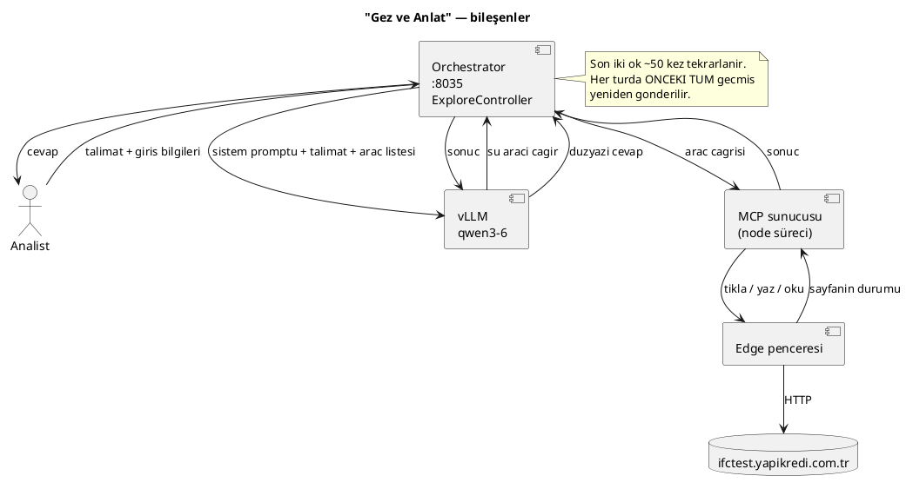
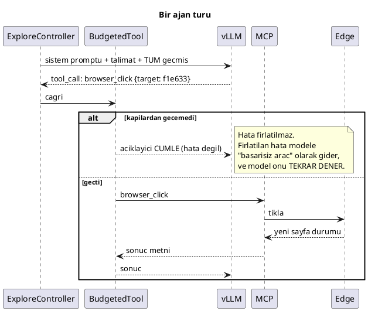
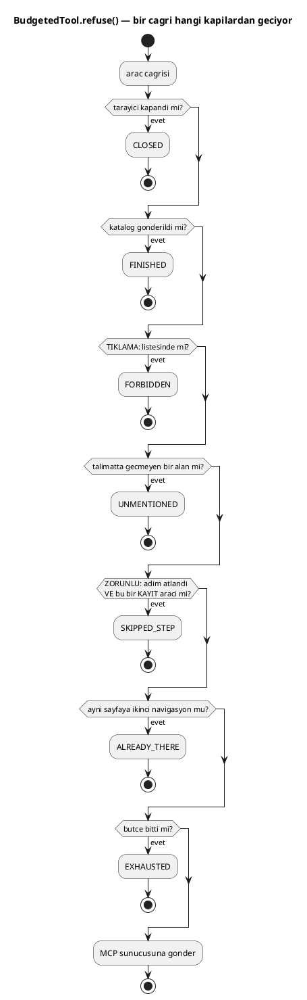

# AI ile Gez ve Keşfet — bir dil modeli gerçek bir tarayıcıyı nasıl sürüyor

Bu doküman **tek bir şeyi** anlatıyor: arayüzdeki **"Gez ve Anlat"** düğmesine
bastığınızda ne oluyor. Bir dil modeli gerçek bir Edge penceresi açıyor,
internet bankacılığına giriyor, ekranları geziyor ve gördüklerini düzyazı
olarak anlatıyor.

Hiçbir şey bilmediğiniz varsayılıyor. "LLM", "MCP", "araç çağrısı" gibi her
terim ilk geçtiği yerde açıklanıyor.

> **Bu doküman katalog üretimini anlatmıyor.** "Katalog Üret" düğmesi aynı
> ajanı kullanır ama sonunda YAML döndürür; o,
> [`AI-KATALOG-URETIMI.md`](AI-KATALOG-URETIMI.md)'nin konusu. Buradaki
> mekanizmanın tamamı orada da geçerli, bu yüzden önce burayı okuyun.

## İçindekiler

1. [Projede üç ayrı "AI" var — karıştırmayın](#1-projede-üç-ayrı-ai-var--karıştırmayın)
2. [Önce dört kavram](#2-önce-dört-kavram)
3. [Büyük resim](#3-büyük-resim)
4. [MCP nedir, nasıl bağlanıyor](#4-mcp-nedir-nasıl-bağlanıyor)
5. [Hangi sunucu araç sürebilir — ve neden hepsi süremiyor](#5-hangi-sunucu-araç-sürebilir--ve-neden-hepsi-süremiyor)
6. [Analist ne yazıyor, sunucu ne gönderiyor](#6-analist-ne-yazıyor-sunucu-ne-gönderiyor)
7. [Araç döngüsü, tur tur](#7-araç-döngüsü-tur-tur)
8. [Neden pahalı: kuadratik büyüme](#8-neden-pahalı-kuadratik-büyüme)
9. [Sistem promptu, kural kural](#9-sistem-promptu-kural-kural)
10. [BudgetedTool — ajanı dışarıdan sınırlamak](#10-budgetedtool--ajanı-dışarıdan-sınırlamak)
11. [DateTool — tarihi modele yazdırmamak](#11-datetool--tarihi-modele-yazdırmamak)
12. [Tarayıcı profili ve pencereyi kapatmak](#12-tarayıcı-profili-ve-pencereyi-kapatmak)
13. [Gerçek bir koşu logu, satır satır](#13-gerçek-bir-koşu-logu-satır-satır)
14. [Ne zaman kullanılır, ne zaman kullanılmaz](#14-ne-zaman-kullanılır-ne-zaman-kullanılmaz)
15. [Ne bozulabilir](#15-ne-bozulabilir)
16. [Sık sorulan sorular](#16-sık-sorulan-sorular)
17. [Doğrulanmamışlar ve bilinen eksikler](#17-doğrulanmamışlar-ve-bilinen-eksikler)

---

## 1. Projede üç ayrı "AI" var — karıştırmayın

Bu projede "AI" kelimesi **üç farklı şey** için kullanılıyor ve üçü birbirine
hiç benzemiyor. Yanlış olanı düşünmek, saatlerce yanlış yerde hata aramak
demek.

```
┌─────────────────────────────────────────────────────────────────────┐
│ 1. MCP AJANI            Bir LLM GERÇEK bir tarayıcı sürüyor.        │
│    (BU DOKÜMAN)         Tıklıyor, yazıyor, sayfayı okuyor.          │
│                         Dakikalar sürer. Milyonlarca token yakar.   │
│                         Tekrarlanabilir DEĞİL.                      │
│                         → "Gez ve Anlat" ve "Katalog Üret"          │
├─────────────────────────────────────────────────────────────────────┤
│ 2. DOM TARAMASI         AI YOK. Hiç model çağrısı yapmaz.           │
│                         Playwright sayfanın HTML'ini okur.          │
│                         Saniyeler sürer. SIFIR token.               │
│                         Tekrarlanabilir.                            │
│                         → "Ekranı Keşfet" (bugün arayüzde kapalı)   │
├─────────────────────────────────────────────────────────────────────┤
│ 3. SENARYO ÜRETECİ      Bir LLM, TEK çağrıda Gherkin yazıyor.       │
│                         Tarayıcı yok, araç yok, durum yok.          │
│                         Saniyeler sürer. ~5.000 token.              │
│                         → "AI Üret" ve "Çoklu Üret"                 │
└─────────────────────────────────────────────────────────────────────┘
```

Ortak yanları yalnızca "bir dil modeli kullanıyor" olmaları. Maliyetleri,
süreleri, güvenilirlikleri ve bozulma biçimleri tamamen farklı.

| | MCP ajanı | DOM taraması | Senaryo üreteci |
|---|---|---|---|
| Tarayıcı sürer mi | **evet** | evet (ama Playwright sürer) | hayır |
| Model çağrısı | ~50 tur | **0** | 1–2 |
| Token | ~2.000.000 | **0** | ~5.000 |
| Süre | 2–10 dk | 1–5 dk | 10–30 sn |
| Aynı girdi → aynı çıktı | **hayır** | evet | evet (temperature 0.3) |
| Ürünü | düzyazı / YAML taslağı | YAML taslağı | `.feature` dosyası |

Bu dokümanın konusu **yalnızca birincisi**.

---

## 2. Önce dört kavram

### 2.1 LLM (dil modeli)

Metin alıp metin üreten bir program. Bu projede bankanın kendi sunucusunda
çalışan **`qwen3-6`** adlı model kullanılıyor
(`spring.ai.openai.chat.options.model`). Model banka dışına çıkmıyor; istek
`vllm-uyz-dsp-genai...yapikredi.com.tr` adresine gidiyor.

Modelin önemli bir sınırı var: **bağlam penceresi 131.072 token**. Token, kabaca
bir kelimenin parçası — Türkçe bir metinde ortalama 3-4 karakter. Modele
gönderdiğiniz her şey ve modelin ürettiği her şey bu pencereye sığmak zorunda.
Sığmazsa koşu ölür. Bu, 8. bölümün tamamının sebebi.

### 2.2 Araç (tool)

Normalde bir LLM yalnızca metin üretir. **Araç**, modele "şu işi yapabilirsin"
demenin yolu. Modele araçların bir listesi verilir; model cevap yazmak yerine
*"`browser_click` aracını `{"target": "f1e633"}` argümanıyla çağırmak
istiyorum"* diyebilir.

Model aracı **kendisi çalıştırmaz.** Yalnızca "şunu çağır" der; çağrıyı bizim
kodumuz yapar ve sonucu modele geri verir. Bu ayrım önemli: modelin tarayıcıya
doğrudan erişimi yok, her şey bizim elimizden geçiyor. 10. bölümdeki tüm
koruyucular bu sayede mümkün.

### 2.3 MCP (Model Context Protocol)

Bir programın, bir LLM'e araç sunmasının standart yolu. Bizim durumumuzda
Microsoft'un **Playwright MCP** sunucusu, bir tarayıcıyı süren araçları
yayınlıyor: `browser_navigate`, `browser_click`, `browser_snapshot`,
`browser_type`, `browser_find` ve diğerleri.

Bu sunucu bizim Java uygulamamızın içinde değil — **ayrı bir node süreci**.
Nasıl başlatıldığı 4. bölümde.

### 2.4 Ajan döngüsü

Bir LLM'e araç verip "şunu yap" dediğinizde ortaya çıkan tekrar eden döngü:

```
model → "şu aracı çağır"  →  biz aracı çağırırız  →  sonucu modele veririz
  ↑                                                             │
  └─────────────────────────────────────────────────────────────┘
                     (model bitti diyene kadar)
```

Buna **ajan** denir: tek bir cevap üreten bir model değil, bir hedefe doğru
adım adım ilerleyen bir model.

**Bu döngünün doğal bir sonu yoktur.** Model ne zaman bittiğine kendi karar
verir — ve bu projede vermedi: akışı baştan sona yürüdü, cevabını yazdı, sonra
giriş sayfasına dönüp **baştan yürümeye başladı**. 10. bölümdeki koruyucular bu
yüzden var.

---

## 3. Büyük resim

```
┌──────────┐   1. "Ne yapsın?" metni + giriş bilgileri
│ ANALİST  │ ──────────────────────────────────────────┐
│ (tarayıcı)                                           │
└──────────┘                                           ▼
                                        ┌───────────────────────────┐
                                        │  ORCHESTRATOR  (:8035)    │
                                        │  ExploreController        │
                                        └───────────┬───────────────┘
                                                    │
          ┌─────────────────────────────────────────┼──────────────────┐
          │ 2. sistem promptu + talimat             │ 3. araç listesi  │
          ▼                                         │                  ▼
┌───────────────────────┐                           │      ┌────────────────────┐
│  vLLM  (qwen3-6)      │◄──────────────────────────┘      │  MCP SUNUCUSU      │
│  bankanın sunucusu    │                                  │  (ayrı node süreci)│
│                       │   4. "browser_click çağır"       │                    │
│                       │ ─────────────────────────────────►│  browser_click     │
│                       │                                  │  browser_snapshot  │
│                       │   5. sonuç (sayfa metni)         │  browser_type ...  │
│                       │ ◄─────────────────────────────────│                    │
│   (4-5 ~50 kez)       │                                  └─────────┬──────────┘
└───────────────────────┘                                            │
                                                                     ▼
                                                        ┌────────────────────────┐
                                                        │  GERÇEK EDGE PENCERESİ │
                                                        │  ifctest.yapikredi...  │
                                                        └────────────────────────┘
```

Aynı resim PlantUML olarak:



**Dikkat edilecek nokta:** model ile tarayıcı arasında **doğrudan bağlantı
yok**. Her şey orchestrator'dan geçiyor. Modelin "tıkla" demesi ile tıklamanın
gerçekleşmesi arasında bizim kodumuz var, ve orada bir dizi kapı duruyor.

---

## 4. MCP nedir, nasıl bağlanıyor

### 4.1 `.mcp.json`

Projenin kökündeki bu dosya, MCP sunucusunun nasıl başlatılacağını söylüyor:

```json
{
  "mcpServers": {
    "playwright": {
      "command": "node",
      "args": [
        "C:/tools/playwright-mcp/node_modules/@playwright/mcp/cli.js",
        "--browser", "msedge",
        "--user-data-dir", "./.mcp-browser-profile",
        "--allowed-origins", "https://ifctest.yapikredi.com.tr;https://intest.yapikredi.com.tr",
        "--output-dir", "./runs/mcp"
      ]
    }
  }
}
```

Satır satır:

| Ayar | Ne yapıyor | Neden önemli |
|---|---|---|
| `command: node` | MCP sunucusu bir **Node.js** programı | Java değil. Ayrı bir süreç, ayrı bir yaşam döngüsü. |
| `C:/tools/playwright-mcp/...` | Paket repo **DIŞINDA** kurulu | Repoda `node_modules` yok; kurulum her makinede elle yapılıyor. |
| `--browser msedge` | Sistemdeki Edge | Playwright'ın kendi Chromium'u değil. Kurumsal SSL denetimi indirmeyi engelliyor. |
| `--user-data-dir ./.mcp-browser-profile` | Tarayıcı profili diskte saklanıyor | **Canlı oturum çerezleri burada.** 12. bölüm. |
| `--allowed-origins` | Yalnızca bu iki adrese gidebilir | Ajan yanlış bir siteye yönelse bile tarayıcı reddeder. |
| `--output-dir ./runs/mcp` | Ekran görüntüleri vb. buraya | Koşu çıktıları. |

### 4.2 Spring AI araçları kendiliğinden buluyor

Java tarafında araçları **kimse elle yazmıyor**. Spring AI'ın MCP istemcisi
sunucuya bağlanıp "hangi araçları sunuyorsun?" diye soruyor ve gelen listeyi
`ToolCallbackProvider` olarak uygulamaya veriyor.

`ExploreController` bu listeyi **olduğu gibi** alıyor:

```java
private final ToolCallbackProvider tools;
```

Sınıfın javadoc'u bunu açıkça söylüyor:

> *"The list is never enumerated here, so adding a tool to the MCP server needs
> no change in this class."*

Yani MCP sunucusuna yeni bir araç eklenirse, Java kodunda **hiçbir şey
değişmez**. Araç adı yalnızca kodun o aracı **tek tek ayırması gereken** üç
yerde geçiyor:

1. `WITHHELD` — modele **verilmeyecek** araçlar (10.2)
2. `CLOSE` (`browser_close`) — bizim kendimiz çağırdığımız araç (12.2)
3. `DateTool`'un bağlandığı `browser_click` + `browser_select_option` ikilisi (11)

Geri kalan her araç isimsiz geliyor.

### 4.3 Hangi araçlar var — nasıl öğrenilir

`GET /api/v1/explore/tools` her aracın **adını, açıklamasını ve argüman
şemasını** döndürüyor. Bu uç nokta bir hata ayıklama aracı ve var olma sebebi
somut:

> *"Whether browser_click's 'target' takes only a snapshot ref or also a
> selector decides whether navigation can be driven from here at all, and that
> question was answered twice by guessing and once by reading an error message
> sideways. The schemas were in memory the whole time."*

Ayrıca: **boş bir liste dönüyorsa modele hiç tarayıcı verilmemiş demektir**, ve
ondan sonraki her hata yanlış yere atfedilir. Bir şey çalışmıyorsa önce buraya
bakın.

### 4.4 Uç nokta kapalı gelir

`ExploreController` şu anotasyonu taşıyor:

```java
@ConditionalOnProperty(name = "uptest.explore.enabled", havingValue = "true")
```

Yani `application.properties` içinde `uptest.explore.enabled=true` yoksa **bu uç
nokta hiç var olmaz**. Sebebi javadoc'ta:

> *"it drives a REAL browser against the REAL test bank: every click is a live
> action, and an endpoint that does that should not exist by accident."*

---

## 5. Hangi sunucu araç sürebilir — ve neden hepsi süremiyor

Bu, kaybedilen zamanın büyük bölümünü açıklayan bölüm ve çoğu kişinin
beklemediği bir gerçeği içeriyor:

> **Bir modelin araç sürebilmesi, modelin değil SUNUCUNUN özelliğidir.**

Model araç çağrısını metin olarak üretir. Bu metni yakalayıp API'nin
`tool_calls` alanına çevirmek **sunucunun işi** ve bu, dağıtım başına ayarlanan
bir şey. Aynı model iki farklı sunucuda farklı davranır.

`application.properties` ölçülmüş üç durumu kaydediyor:

| Sunucu + model | Sonuç |
|---|---|
| **A** (doğrudan vLLM) + `qwen3-6` | **Çalışıyor.** Ajan DBS akışını yürüdü ve `submit_catalog` ile kapattı. |
| **B** (bifrost proxy) + `gpt-oss-120b` | **Yanlış ayrıştırıcı.** gpt-oss "harmony" konuşuyor; kontrol token'ları çağrıya sızıyor: `browser_find<\|channel\|>commentary` adında bir fonksiyon, `target=null` ile snapshot, selector argümanına itilmiş bir snapshot referansı. |
| **B** + **aynı qwen** | **Hiç ayrıştırılmıyor.** Çağrı düz metin olarak cevabın içinde geliyor: `browser_navigate<parameter=url>...</parameter></function></tool_call>`. Hiçbir araç çalışmıyor. |

Üçüncü satır en sinsisi: model doğru şeyi yapıyor ama kimse dinlemiyor, ve
`/explore/catalog` *"Model hiçbir katalog aracını çağırmadı"* diyor — sanki
model tembellik etmiş gibi.

Properties dosyasındaki not açık: *"Neither B failure is fixable from here."*
Bozuk bir adı kırpmak kırılmayı argümanlara taşır, ve content alanındaki metin
zaten hiçbir zaman bir araç çağrısı değildi. B'nin ajanı koşturabilmesi için
platform ekibinin her modele uygun ayrıştırıcıyı (gpt-oss için harmony, qwen
için hermes) açması gerekiyor.

**Pratik sonuç:** ajan yalnızca A uç noktasıyla çalışır. Bugün aktif olan da o.

---

## 6. Analist ne yazıyor, sunucu ne gönderiyor

### 6.1 Ekrandaki alanlar

Ajan panelinde yedi alan var:

| Alan | Örnek | Zorunlu |
|---|---|---|
| Adres | `https://ifctest.yapikredi.com.tr/ngc/indexNgc.do` | hayır |
| Firma / Müşteri Kodu | `DI00002018` | hayır |
| Kullanıcı Kodu | `1335` | hayır |
| Şifre | *(şifre alanı)* | hayır |
| Akıllı SMS kodu | `34020` | hayır |
| Ana menü | `NAKİT YÖNETİMİ` | hayır |
| **Ne yapsın?** | *(serbest metin)* | **evet** |

Yalnızca sonuncusu zorunlu — zaten giriş yapılmış bir akış diğerlerinin
hiçbirine ihtiyaç duymaz.

### 6.2 Kimlik bilgileri neden ayrı alanlarda

Eskiden CIF ve şifre serbest metnin içine yapıştırılıyordu. İki sorun çıktı:
her koşunun giriş cümlesi biraz farklı oluyordu, ve bir şifre bir paragrafın
ortasında duruyordu.

Şimdi `ExploreController.compose()` giriş bölümünü **her seferinde aynı
şekilde** yazıyor:

```
https://ifctest.yapikredi.com.tr/ngc/indexNgc.do adresine git.
Giriş yap:
- Firma Kodu / Müşteri Kodu = DI00002018
- Kullanıcı Kodu = 1335
- Şifre = ••••••
- #btnSubmit
Akıllı SMS ekranı gelirse #otpPassword alanına 34020 yaz, tekrar giriş yap.
Ana menü: NAKİT YÖNETİMİ

<analistin yazdığı metin buraya>
```

### 6.3 Bu birleştirilmiş metin yük taşıyor

Önemli ve kolay kaçırılan bir ayrıntı: **koruyucular ham metni değil, bu
birleştirilmiş metni okuyor.**

`BudgetedTool`, talimatta adı geçmeyen bir alana dokunulmasını reddediyor (10.4).
Giriş kutuları da birer alan. Ham metinde geçmedikleri için, birleştirme
yapılmasaydı **ajan giriş bile yapamayacaktı** — kendi kendini engellerdi.

### 6.4 İki özel satır: `TIKLAMA:` ve `ZORUNLU:`

Analist talimatın herhangi bir satırına şunları yazabilir:

```
TIKLAMA: Garantili Ödeme, Fatura numarası eklemek istiyorum
ZORUNLU: Ödenecekler
```

- **`TIKLAMA:`** — bu kontrollere **dokunulmayacak**. Virgülle ayrılır.
- **`ZORUNLU:`** — bu kontrollere **mutlaka dokunulacak**.

Neden bir işaret kelimesi, neden düz cümle değil? Çünkü düz metinden olumsuzluk
çıkarmak dilin tahmin edilmesi demek, ve **biri farklı bir cümle kurduğu anda
sessizce çalışmayı bırakır.** İşaretli satır bir sözleşme: ya vardır ya yoktur.

İkisi arasında önemli bir fark var:

- `TIKLAMA:` **zorlanır.** Yasaklı bir kontrole giden çağrı reddedilir.
- `ZORUNLU:` **zorlanamaz** — buradan bir araç çağrısı yaratılamaz. Yapabildiği
  şey, atlanırsa **bildirmek**.

İkincisinin var olma sebebi, yanlış bir düğmeye basmaktan daha kötü bir hata:
numaralı bir adımda "şu listeye geç" denmişti, ajan geçmedi, hata da vermedi ve
**yanlış listenin doğru satırını** seçip kataloğa yazdı. Sonraki her adım
başarılı oldu. Fark edilmesinin tek yolu bir referans numarasını ekran
görüntüsüyle karşılaştırmaktı.

---

## 7. Araç döngüsü, tur tur

### 7.1 Tek bir turun anatomisi

```
TUR N
├─ Biz modele gönderiyoruz:
│    • sistem promptu          (her turda aynı, ~2.200 token)
│    • analistin talimatı      (her turda aynı)
│    • ÖNCEKİ TÜM TURLAR       (büyüyen kısım)
│    • araç listesi + şemaları
│
├─ Model cevap veriyor: "browser_click çağır, {"target":"f1e633"}"
│
├─ Çağrı BudgetedTool'dan geçiyor  →  kapılar (10. bölüm)
│    ├─ reddedilirse: modele bir CÜMLE dönüyor, araç hiç çalışmıyor
│    └─ geçerse: MCP sunucusuna gidiyor
│
├─ MCP sunucusu Edge'e komut veriyor, sonucu döndürüyor
│
└─ Sonuç modele veriliyor → TUR N+1
```

### 7.2 PlantUML



### 7.3 Reddetme neden cümle, neden hata değil

`BudgetedTool` hiçbir zaman istisna fırlatmıyor. Javadoc sebebi söylüyor:

> *"Both answer with a SENTENCE, never an exception. A thrown error reaches the
> model as a failed tool, and a failed tool is exactly what it retries."*

Modele "bu araç patladı" derseniz tekrar dener. "Bunu yapma, çünkü şu, bunun
yerine şunu yap" derseniz okuyup yoluna devam eder. Reddetme mesajlarının hepsi
bu yüzden tam cümleler hâlinde yazılmış.

---

## 8. Neden pahalı: kuadratik büyüme

Bu, ajanın en önemli özelliği ve kullanım kararını belirleyen şey.

### 8.1 Her tur, önceki her şeyi yeniden gönderir

Dil modellerinin hafızası yok. "Üçüncü turda ne demiştin?" diye hatırlayamaz.
Hatırlaması için **önceki her şeyi her turda yeniden göndermek** zorundayız.

```
Tur  1:  [prompt]
Tur  2:  [prompt][tur1]
Tur  3:  [prompt][tur1][tur2]
Tur  4:  [prompt][tur1][tur2][tur3]
...
Tur 50:  [prompt][tur1][tur2]..............[tur49]   ← pencere dolmaya yakın
         ───────────────────────────────────────────────────────────
         FATURA = her turun bağlamının TOPLAMI, tek bir turun değil
```

Her kutu bir öncekinden büyük. Ödenen şey en büyük kutu değil, **tüm kutuların
toplamı.**

Elli tur için toplam prompt token'ı, turların toplamıdır — yani kabaca
**tur sayısının karesi** ile büyür. Buna kuadratik denir.

### 8.2 Ölçülmüş boyutlar

Ölçüm, 2026-10-09'da `wc -m` ile:

| Parça | Karakter | ≈ Token |
|---|---|---|
| `SYSTEM` — ajan sistem promptu | 8.353 | ~2.200 |
| `CATALOG_RULES` — yalnızca katalog uç noktasında | 8.382 | ~2.200 |
| `catalogs/SCHEMA.md` — prompta aynen girer | 14.380 | ~3.800 |
| Bir sayfa anlık görüntüsü (üst sınır) | 12.000 | ~3.000 |

Buradan iki farklı sistem promptu çıkıyor:

| Uç nokta | Sistem promptu | ≈ Token |
|---|---|---|
| `/api/v1/explore` ("Gez ve Anlat") | `SYSTEM` | **~2.200** |
| `/api/v1/explore/catalog` ("Katalog Üret") | `SYSTEM + CATALOG_RULES + SCHEMA.md` | **~8.200** |

Katalog uç noktası neredeyse dört kat ağır başlıyor — ve bu ağırlık **her
turda** yeniden gönderiliyor.

### 8.3 Karşılaştırma

```
BIR ajan kesfi        ≈ 2.000.000 token
BES senaryo uretimi   ≈    40.000 token
                        ─────────────
ORAN                  ≈ 40-80 KAT
```

### 8.4 Pencere dolarsa ne olur

Model 131.072 token taşıyabiliyor. Yirmi tam sayfa anlık görüntüsü alan bir
koşu bu pencereyi doldurur ve **yarıda ölür**. Sistem promptundaki en sert
kurallardan biri tam olarak bunun için:

> *"A full snapshot of one of these pages is enormous, EVERY one you take stays
> in this conversation for the rest of the task, and a run that takes twenty of
> them simply runs out of room and dies half-finished."*

Çözüm "promptu kısaltmak" değil — sistem promptu toplamın küçük bir parçası.
Çözüm **daha az ve daha küçük anlık görüntü almak**: tam sayfa yerine metin
araması, ya da sayfanın tamamı yerine tek bir tablo.

### 8.5 Son çare: sonuçlar kırpılıyor

Prompt kuralı yetmediğinde devreye giren bir kod koruması var.
`BudgetedTool.trim()` **12.000 karakterden** uzun her araç sonucunu kesiyor
(`LARGEST_RESULT = 12_000`).

Bu sınır bir başarısızlıktan ölçüldü: yirminci anlık görüntü civarında bir koşu
durdu — *"maximum context length is 131072 tokens ... your prompt contains at
least 131073"*. Akışta yanlış bir şey yoktu; dakikalarca gerçek tarayıcı
zamanından sonra **yer kalmadığı için yarıda bitti**.

Sınır bilerek cömert: bir formun tüm alan listesi hayatta kalmalı, yoksa tedavi
yürüyüşün amacını siliyor. Durdurduğu şey sınırsız hâli.

Ve kesilen sonuç sessizce kısalmıyor — modele bir not bırakıyor:

```
[... kesildi. Bu sayfa tek bir cevaba sigmayacak kadar buyuk. Aradigin sey
burada yoksa TUM sayfayi yeniden okuma: metinle arayan araci kullan, ya da
snapshot'i target/depth ile daralt.]
```

Not modele hitap ediyor, çünkü sessizce kısaltılmış bir sayfa onu yalnızca
kesilmiş bir alanı aramaya gönderirdi.

Logda da görünüyor:

```
[uptest] explore: browser_snapshot sonucu 48213 karakter — 12000'e kisaltildi
```

Bu satırı çok görüyorsanız, ajan tam sayfa anlık görüntüsü alıyor demektir ve
koşu bağlamı yakıyor.

### 8.6 Para cinsinden maliyet

**Yok.** Model bankanın kendi vLLM dağıtımında çalışıyor; dışarıya fatura
kesilmiyor. Gerçek para birimi üç şey:

1. **Duvar saati** — bir keşif 2-10 dakika.
2. **GPU doluluğu** — sunucu başka ekiplerle paylaşılıyor.
3. **Bağlam tavanı** — 131.072 token; aşılırsa koşu ölür.

Ölçek fikri olsun diye: ticari bir API'de küçük bir model için tipik olan
~0,5 $/1M girdi fiyatıyla bir ajan keşfi ≈ 1 $, beş senaryo üretimi ≈ 0,02 $
ederdi.

---

## 9. Sistem promptu, kural kural

Sistem promptu `ExploreController.SYSTEM` içinde. Buradaki her kural **gerçek
bir hatadan** doğdu. Hiçbiri "iyi olur" diye yazılmadı.

### 9.1 "Önce bak"

> *Snapshot when the PAGE CHANGES, and work from that snapshot's references
> until it changes again.*

Gezinen bir ajanın alışıldık hatası yanlış elemanı seçmek değil — **hiç
bakmamak**: sayfayı okumak yerine hafızasından bir selector uyduruyor.

Ama dengesi var: değişmemiş bir sayfayı on üç kez okumak iki dakikalık bir
yürüyüşü on dakikaya çıkarıyor. Kural bu yüzden "her alandan önce oku" değil,
"**sayfa değiştiğinde** oku".

### 9.2 "Tek eleman arıyorsan ARA, anlık görüntü ALMA"

MCP sunucusunda sayfada metin arayıp yalnızca eşleşen düğümleri döndüren bir
araç var. Bir alanı, düğmeyi ya da satırı ararken bunu kullanmak gerekiyor —
sebebi 8.4'te.

### 9.3 "Uygulamanın formu değiştirmesi de bir değişikliktir"

Doldurduğunuz bir alan bir şey tetiklediğinde (başka bir alan kendiliğinden
dolar, bağımlı bir liste yüklenir) birkaç saniye bekleyip **sayfayı yeniden
okumak** gerekiyor. Yoksa o tepkiden sonraki her alan eski bir haritadan
adresleniyor.

### 9.4 "Başarısız bir eylemden sonra sayfayı oku"

Bir tıklama ya da yazma hata dönerse: tekrarlama, ve aynı elemanı başka türlü
adlandırmaya çalışma. **Önce bak.** Eleman taşınmış olabilir, iki tane olabilir,
ya da hiç olmayabilir. *"A guess repeated is still a guess."*

### 9.5 "Hiçbir şeyi değiştirmeyen bir tıklama hata değildir"

Bu, promptun kendi ifadesiyle **"en kötü hata"**:

> *"This is the worst failure there is: nothing looks wrong, and you walk the
> rest of the flow perfectly on the wrong screen."*

Bir sekme ya da filtre değiştirmek için tıkladığınızda, araç başarı
raporlayabilir ama sayfa hâlâ eskisini gösteriyor olabilir. Bu listeler arka
planda çekiliyor; **önce birkaç saniye bekleyip sonra okumak** gerekiyor. Erken
okumak eskisini gösterir, ve bu hiçbir şey yapmamış bir tıklamaya birebir
benzer.

### 9.6 "Tarihler yalnızca `set_date` ile"

11. bölümün tamamı bu.

### 9.7 "Bir tutar iki kutudur"

Lira ve kuruş yan yana iki ayrı input. Formun gerçekte okuduğu değer
**ikisinden hesaplanıyor**. Tek kutuya `1.250,50` yazarsanız kutular dolu
görünür, form hiçbir şey okumaz, gönder dediğinizde ekran "Toplam tutar
giriniz" der — **ve ekran haklıdır**, gerçekten boştur.

### 9.8 "Buradaki dropdown'lar gerçek `<select>` değil"

Neredeyse hepsi özel bir widget — dropdown gibi görünen bir `span`. Seçenek
seçen araç bunlarda *"Element is not a `<select>` element"* ile patlıyor.
Bir insan gibi sürmek gerekiyor: **aç, oku, seçeneği tıkla.**

Ve seçeneğin metnini **listeden kopyalamak** gerekiyor. Hafızadan yazmak
`"Taksitli Ödnsin"` gibi şeyler üretiyor — hiçbir şeyle eşleşmiyor ve var
olmayan bir arıza aratıyor.

### 9.9 "Talimat, dokunabileceğin şeylerin TAM listesidir"

Ekranda talimatın adını anmadığı her şey — düğme, onay kutusu, açılır bölüm,
değer verilmemiş bir alan — **okunacak ve kaydedilecek, asla basılmayacak,
doldurulmayacak, işaretlenmeyecek.**

> *"On these screens an unasked-for button does not add detail, it changes what
> the transaction IS."*

Tek istisna, verilmiş bir değeri **ayarlamak için gereken** kontroller: bir
dropdown'ın içindeki seçenek, bir takvimdeki gün hücresi, bir seçicideki satır.

### 9.10 "Burası bir banka"

Kayıt oluşturan, onaylayan veya iptal eden hiçbir şeye, talimat söylemedikçe
basılmayacak. Söylediğinde **bir kez** basılacak ve sonraki ekran beklenecek.
Cevap yavaş diye ikinci kez basılmayacak — kayıt zaten yolda.

### 9.11 "JavaScript yazma"

10.2'de.

---

## 10. BudgetedTool — ajanı dışarıdan sınırlamak

`BudgetedTool`, her araç çağrısının önüne geçen bir sarmalayıcı. Her çağrı
önce buradan geçiyor.

### 10.1 Kapılar ve sırası

```
                        ARAÇ ÇAĞRISI
                             │
                             ▼
         ┌───────────────────────────────────────┐
         │ 1. Tarayıcı kapandı mı? (aborted)     │──► CLOSED
         │    Her şeyden önce. Bütçeden düşmez.  │
         ├───────────────────────────────────────┤
         │ 2. Katalog gönderildi mi?             │──► FINISHED
         │    (yalnızca katalog uç noktasında)   │
         ├───────────────────────────────────────┤
         │ 3. Yasaklı kontrol mü? (TIKLAMA:)     │──► FORBIDDEN
         ├───────────────────────────────────────┤
         │ 4. Talimatta geçmeyen alan mı?        │──► UNMENTIONED
         ├───────────────────────────────────────┤
         │ 5. Zorunlu adım atlandı mı?           │──► SKIPPED_STEP
         │    (yalnızca KAYIT araçları için)     │
         ├───────────────────────────────────────┤
         │ 6. Aynı sayfaya ikinci gidiş mi?      │──► ALREADY_THERE
         ├───────────────────────────────────────┤
         │ 7. Bütçe bitti mi? (250)              │──► EXHAUSTED
         └───────────────────┬───────────────────┘
                             ▼
                      MCP SUNUCUSUNA
```



Sıra rastgele değil. İptal en başta, çünkü javadoc'un dediği gibi *"a closed
browser is the operator saying stop"* — bütçeden düşülmemeli ve tartışılmamalı.
Katalog kontrolü de bütçe harcamadan yapılıyor: katalog geldikten sonra ajanın
yaptığı hiçbir şey onu iyileştiremez, ama her şey analistin isteğini bekletir.

### 10.2 `WITHHELD` — verilmeyen iki araç

```java
private static final Set<String> WITHHELD =
        Set.of("browser_run_code_unsafe", "browser_evaluate");
```

İkisi de JavaScript çalıştırıyor. Verildiğinde model **tıklamayı bırakıp kod
yazmaya başladı** ve kendi hatalarında döngüye girdi:
`SyntaxError: Unexpected token ';'`, `ReferenceError: require is not defined`.
Hiçbir zaman bir cevaba ulaşmadı.

Ayrıca `browser_run_code_unsafe` kendi açıklamasına göre uzaktan kod çalıştırma
eşdeğeri — bir bankanın içinde bir modele verilecek bir şey değil.

### 10.3 Bütçe — son çare

```java
@Value("${uptest.explore.tool-budget:250}") int budget
```

250 çağrı. Bu **kaba** koruyucu; asıl işi gören 10.5'teki navigasyon kontrolü.
Javadoc tavanın neden bu kadar yüksek olduğunu hesaplıyor:

> DBS fatura yürüyüşü = giriş (~6 çağrı) + menü (~4) + on üç alan, her biri
> önce okunarak (~26) + üç gönderim ve anlık görüntüleri (~8) ≈ **elli**.

Yani 250'ye ulaşmak, **sayıyı artırmanın çözmeyeceği** bir sorun var demektir.

### 10.4 Talimatta geçmeyen alan

Bu kural önce bir prompt kuralıydı (9.9) ve yine de kırıldı: açıkça
söylenmesine rağmen ajan `"Garanti Tutarı"` alanına yazdı — talimatın hiç
anmadığı ve **işlemin ne olduğunu değiştiren** bir alan.

Koruyucunun bir alanı diğer her şeyden ayırt etmesi gerekiyor. Bunu nasıl
yapıyor? **Ajanın kendi `note_field` çağrılarından.** Sayfada "Garanti Tutarı
lira kutusu" ile "25 gün hücresi" dışarıdan aynı görünüyor; hangisinin bu formun
bir ALANI olduğunu yalnızca ajanın kendi kayıtları söylüyor.

Dört harften kısa etiketler eşleştirmeye katılmıyor (`SHORTEST_LABEL = 4`) —
iki harflik bir etiket sayfadaki argümanların yarısının içinde tesadüfen geçer,
ve **tesadüfen ateşlenen bir koruyucu, hiç olmamasından kötüdür.**

### 10.5 Aynı sayfaya ikinci gidiş

Ajan döngüsünün doğal sonu olmadığını 2.4'te söylemiştik. Gerçekte olan şey:
akışı yürüdü, cevap verdi, **sonra baştan başladı.**

Bunun imzası, daha önce ziyaret edilmiş bir sayfaya ikinci kez gitmek. Bu akış
menülerle yürünüyor, adres yazarak değil — ikinci bir navigasyon ya baştan
başlamak ya da bir şeyden kurtulmaya çalışmak, ve ikisi de istenmiyor.

### 10.6 İptal — tarayıcı kayboldu

Üç imza aranıyor:

| İmza | Ne demek |
|---|---|
| `has been closed` | Pencere çağrının ortasında kapandı. **Fırlatılan** bir hata olarak geldi, dönen değil — ilk sürümün onu hiç görmemesinin sebebi bu. |
| `no open pages` | Geriye hiçbir şey kalmamışken yapılan bir çağrı. |
| `about:blank` | **Sessiz olan.** MCP sunucusu bir araç ihtiyaç duyduğunda tarayıcı açıyor; operatör pencereyi kapattıktan SONRAKİ çağrı başarılı olabilir — yeni bir tarayıcı, boş bir sayfa, boş bir anlık görüntü ve hiçbir yerde hata yok. Koşu kimsenin istemediği bir pencerede devam eder. |

Üçüncüsü navigasyonun **kendi sonucunda** aranmıyor — bir navigate, terk ettiği
boş sayfayı meşru olarak raporlar, ve orada bakmak her koşuyu ilk çağrısında
iptal ederdi.

> **Bilinen sorun:** iptal kapısı şu anda `submit_catalog`'u da reddediyor. Bu,
> eksiksiz bir kataloğun tarayıcı kaybolduğu için çöpe gitmesine yol açtı.
> Ayrıntı 17. bölümde.

---

## 11. DateTool — tarihi modele yazdırmamak

Bu, promptun yetmediğinin en net kanıtı. **Üç ayrı prompt kuralı yazıldı,
üçü de kırıldı:**

| Deneme | Sonuç |
|---|---|
| Tek seferde yaz | Maskeli kutu boş maskesini geri boyar ve başarı raporlar. |
| Karakter karakter yaz | Kutu boş değilse rakamlar eskilerle iç içe geçer: **`20/26/2509`** — hem de zaten doğru ayarlanmış bir alanda. |
| Takvimi kendin sür | Ajan ayı değiştirmeden gün tıkladı. Kendisi raporladı: *"clicking day 25 and pressing Tamam does not consistently update the field"*. |

`DateTool`'un javadoc'u teşhisi koyuyor:

> *"None of that is a reasoning problem. It is a four-step sequence whose order
> is load-bearing, and the fix is to stop asking."*

### 11.1 Ne yapıyor

Ajana `set_date` adında **tek bir araç** veriliyor. Ajan yalnızca iki şey
söylüyor: hangi kutu, hangi tarih. Dört çağrı bizim:

```
1. kutuyu tıkla            → takvim açılır
2. YILI seç                → #ui-datepicker-year
3. AYI seç                 → #ui-datepicker-month   (0 tabanlı!)
4. GÜN hücresini tıkla     → a:text-is("25")
```

**Sıra yük taşıyor:** yıl ya da ay değiştirmek gün ızgarasını yeniden çiziyor,
yani önce seçilmiş bir gün atılıyor. Bu sıra, ajan var olmadan önce
`CommonActions.pickFromCalendar`'ın bu uygulamaya karşı kullandığı sıranın ta
kendisi.

İki ayrıntı:

- **Ay 0 tabanlı gönderiliyor** (Ocak = 0). jQuery UI'ın kendi değeri. Türkçe ay
  adı kullanılmıyor çünkü ad sayfanın diline bağlı, sayı değil.
- **Gün `text-is` ile** aranıyor, içerir ile değil: `"2"` ne `"12"` ne de
  `"20"` ile eşleşmeli.

### 11.2 Bütçeye sayılmıyor

`DateTool` **ham** araçlara bağlanıyor, sarmalanmışlara değil:

```java
DateTool dates = DateTool.bind(tools.getToolCallbacks());
```

Çünkü dört çağrıyı biz yapıyoruz, model değil. Sarmalasaydık tek bir tarih
bütçeden dört kez düşer ve loglarda modelin kendi hamleleri gibi görünürdü.

Ama `set_date`'in kendisi sıradan bir `@Tool` nesnesi olarak veriliyor, yani
**o** bütçeden düşüyor.

### 11.3 Kendi logunu tutuyor

Dört çağrı `BudgetedTool`'dan geçmediği için loglarda görünmezlerdi. `DateTool`
bu yüzden kendi satırlarını basıyor:

```
[uptest] set_date: open the field -> {"target":"#invoiceDate"}
[uptest] set_date: choose the year -> {"target":"#ui-datepicker-year","values":["2026"]}
[uptest] set_date: choose the month -> {"target":"#ui-datepicker-month","values":["9"]}
[uptest] set_date: click the day -> {"target":"#ui-datepicker-div a:text-is(\"25\")"}
```

Bu olmasaydı sessizce başarısız olan bir tarih, logda tek bir `set_date` satırı
olarak görünür ve dört adımdan hangisinin patladığı hiç bilinmezdi.

### 11.4 Araç yoksa verilmiyor

```java
return click == null || select == null ? null : new DateTool(click, select);
```

MCP sunucusu `browser_click` ve `browser_select_option` ikilisini sunmuyorsa
ajan bu aracı **hiç almıyor** — her çağrıda patlayan bir araç almaktansa.

---

## 12. Tarayıcı profili ve pencereyi kapatmak

### 12.1 `.mcp-browser-profile/` — asla commit edilmez

`--user-data-dir ./.mcp-browser-profile` tarayıcı profilini diske yazıyor.
İçinde **canlı oturum çerezleri** var — yani giriş yapılmış bir bankacılık
oturumu.

`.gitignore` bunu koruyor (satır 17). **Bu satır kaldırılmamalı.**

Bunun bir yan etkisi var ve bilinmesi gerekiyor: **sonraki koşu kendini zaten
giriş yapmış bulabilir.** Pencereyi kapatmak oturumu sonlandırmıyor, çünkü
çerezler diskte.

### 12.2 `closeBrowser()` — neden bizim işimiz

Model döngüsünün bitmesi tarayıcıyı bitirmiyor. MCP sunucusu uygulamayla
birlikte başlayan **uzun ömürlü bir süreç** ve sayfasını son koşunun bıraktığı
yerde açık tutuyor. Sonraki keşif boş bir sekme yerine **önceki koşunun sonuç
ekranında** başlıyor — bu da aynı talimatın iki koşusunu iki farklı koşu
yapıyor.

Kapatmak **bizim** işimiz, modelin değil:

> *"Told to close the browser, an agent forgets, or closes it early and then
> needs it again. A finally block does not."*

Bu yüzden `closeBrowser()` bir `finally` bloğunda — hem başarı hem hata
yolunda. Yarıda ölen bir koşu, biten bir koşudan daha garip bir yerde bırakır.

Ve asla fırlatmıyor: katalog zaten üretilmişken temizlik patladı diye onu
kaybetmek saçma olurdu. Ama **eksik bir araç raporlanıyor** — sessizlik,
başarılı bir kapatmaya birebir benzerdi:

```
[uptest] explore: 'browser_close' diye bir arac yok; tarayici acik
kaliyor ve sonraki kosu onceki ekrandan basliyor
```

---

## 13. Gerçek bir koşu logu, satır satır

Elimizdeki gerçek bir koşunun sonu. Bir logun nasıl okunacağını gösteriyor.

```
 1  [uptest] explore -> browser_wait_for {"time": 2}
 2  [uptest] explore -> browser_find {"text": "Normal"}
 3  [uptest] explore -> browser_click {"target": "f1e1236"}
 4  [uptest] explore -> note_field {"label": "Fatura Tipi", "type": "dropdown",
                        "options": ["Normal","E-Fatura","E-Arşiv Fatura"], ...}
 5  [uptest] explore -> browser_find {"text": "Devam"}
 6  [uptest] explore -> browser_click {"target": "f1e633"}
 7  [uptest] explore -> browser_wait_for {"time": 3}
 8  [uptest] explore -> browser_find {"text": "Onay"}
 9  [uptest] explore -> browser_snapshot {"target": "f1e1267"}
10  [uptest] explore -> note_confirmation {"labels": [... 15 etiket ...]}
11  [uptest] explore -> note_field {"label": "Kurum", "type": "text", ...}
12  [uptest] explore -> browser_find {"text": "Onay"}
13  [uptest] explore -> browser_click {"target": "f1e1357"}
14  [uptest] explore -> browser_wait_for {"time": 15}
15  ERROR ... Error calling tool: ... Error: No open pages available.
16  [uptest] explore: tarayici yok ("no open pages") — kosu sonlandiriliyor
17  [uptest] explore -> browser_tabs {"action": "list"}
18  [uptest] explore -> browser_navigate {"url": "https://ifctest..."}
19  [uptest] explore -> submit_catalog {"app":"NGC", ... eksiksiz ...}
```

Okunuşu:

- **1-3:** ajan doğru davranıyor — bekliyor, tam sayfa anlık görüntüsü yerine
  **arama** yapıyor (9.2), sonra tıklıyor.
- **4:** dropdown'ı seçenekleriyle kaydediyor. Açmış ve listeyi okumuş.
- **6-7:** "Devam"a basıyor, 3 saniye bekliyor. 9.5'teki kural.
- **9:** burada **tam sayfa değil, tek bir hedefin** anlık görüntüsü alınıyor
  (`target: f1e1267`) — onay tablosu. Bu, 8.4'teki tavsiyeye uyuyor.
- **10:** onay ekranındaki on beş etiketi kaydediyor. Doğru an, doğru çağrı.
- **13:** son "Onay" düğmesine basıyor. Talimat söylemiş olmalı (9.10).
- **14:** on beş saniye bekliyor.
- **15-16:** **tarayıcı kayboldu.** İptal kuruldu (10.6).
- **17-18:** ajan toparlanmaya çalışıyor — sekmeleri listelemek, yeniden
  gitmek. **İkisi de reddedildi**, ve 18 doğru şekilde reddedildi: yeni bir
  pencere açardı.
- **19:** ajan kataloğu **eksiksiz** gönderdi — ve **o da reddedildi.**

Son satır bir hata ve 17. bölümde duruyor. Ama logun geri kalanı ajanın doğru
çalıştığını gösteriyor: aradı, bekledi, okudu, kaydetti, bitirdi.

**Bir logu okurken aranacak şeyler:**

| Desen | Anlamı |
|---|---|
| Arka arkaya çok sayıda `browser_snapshot` | Bağlam yanıyor; koşu yarıda ölebilir |
| Aynı `browser_click` iki kez | Model bir şeyi tekrar deniyor — 9.4 kırılmış |
| `browser_navigate` ikinci kez | Baştan başlıyor; `ALREADY_THERE` görmelisiniz |
| `note_field` yok, çok sayıda tarama var | Ajan geziyor ama kaydetmiyor |
| `No open pages` / `has been closed` | Tarayıcı gitti; sonraki her şey reddedilir |

---

## 14. Ne zaman kullanılır, ne zaman kullanılmaz

### Kullanın

- **Bir ekrana nasıl gidildiğini bulmak.** Menü, alt menü, sekme, ızgara
  satırı, formu açan düğme. Bir insanın ilk kez keşfetmesi gereken şey.
- **Onay ekranını ve başarı mesajını görmek.** DOM taraması oraya ulaşamıyor,
  çünkü son düğmeye hiç basmıyor.
- **Tarama seçicisinin göremediği alanları bulmak.** Tarama yalnızca
  `fieldcontainer` içine bakıyor ve "Ek Bilgi"yi kaçırdı.

### Kullanmayın

- **Tekrarlanabilir bir sonuç gerektiğinde.** Aynı ekran bir koşuda `"Ay"`,
  sonrakinde `"Ay, Hafta, Gün"` verdi.
- **Alan tiplerini kesinleştirmek için.** Erişilebilirlik anlık görüntüsü
  Select2 v3 ile v4'ü ayırt edemiyor, bir tutarın iki input olduğunu göremiyor,
  bir datepicker'ı metin kutusundan ayıramıyor.
- **`max_length` / `numeric` gibi kısıtlar için.** Bunlar DOM attribute'u;
  anlık görüntüde hiç yok. Yalnızca DOM taraması verebilir.
- **Hızlı bir cevap için.** 2-10 dakika.

**Doğru kullanım, ikisini birden koşup farkı okumaktır.** "Ek Bilgi" alanı ve
kaçırılmış bir `verifiable` böyle bulundu.

---

## 15. Ne bozulabilir

| Belirti | Muhtemel sebep | Nereye bakılır |
|---|---|---|
| `/api/v1/explore` 404 | `uptest.explore.enabled` açık değil | `application.properties` |
| Araç listesi boş | MCP sunucusu başlamamış; node yolu yanlış | `GET /api/v1/explore/tools`, `.mcp.json` |
| "Model hiçbir aracı çağırmadı" | **Uç nokta araç çağrılarını ayrıştırmıyor** | 5. bölüm — B uç noktası |
| Araç adında `<\|channel\|>` gibi şeyler | Yanlış ayrıştırıcı (harmony/hermes) | 5. bölüm |
| Koşu yarıda ölüyor, cevap yok | Bağlam penceresi doldu | 8.4 — anlık görüntü sayısı |
| Ajan aynı şeyi tekrar deniyor | Reddetme mesajını okumamış ya da gerçek bir hata | Logda reddetme cümlesini arayın |
| `ALREADY_THERE` görüyorsunuz | Ajan baştan başlamaya çalışmış | Normal — koruyucu çalışıyor |
| Her çağrı `CLOSED` dönüyor | Tarayıcı kapanmış | 10.6; koşuyu tekrarlayın |
| Sonraki koşu zaten giriş yapmış | Profil çerezleri diskte | 12.1 — beklenen davranış |
| Tarih `20/26/2509` gibi | `set_date` kullanılmamış | 11. bölüm |

---

## 16. Sık sorulan sorular

**Model bankanın verilerini dışarı gönderiyor mu?**
Hayır. vLLM bankanın kendi altyapısında. MCP sunucusu yerel bir node süreci.
Tarayıcı yalnızca `--allowed-origins` ile izin verilen iki adrese gidebiliyor.

**Neden bu kadar yavaş?**
Her tur bir model çağrısı ve her model çağrısı önceki her şeyi yeniden
gönderiyor (8. bölüm). Elli tur, elli model çağrısı demek.

**Ajan yanlış bir düğmeye basarsa ne olur?**
Test ortamında da kayıt oluşur. Bu yüzden 9.9, 9.10 ve `TIKLAMA:` var. Ama
hiçbiri mutlak değil — **ajan gerçek bir tarayıcı sürüyor ve gerçek işlemler
yapabiliyor.**

**Aynı talimatı iki kez koşarsam aynı sonucu alır mıyım?**
Hayır. Ajan tekrarlanabilir değil (14. bölüm). Tekrarlanabilirlik isteyen
DOM taramasını kullanmalı.

**Bütçeyi artırsam daha iyi olur mu?**
Neredeyse kesinlikle hayır. 250'ye ulaşmak bir döngü demek, ve döngü sayı
artırarak bitmez (10.3).

**`Gez ve Anlat` ile `Katalog Üret` arasındaki fark ne?**
Aynı ajan, aynı sistem promptu, aynı koruyucular. Fark: katalog uç noktası
modele üç ek araç veriyor (`note_field`, `note_confirmation`, `submit_catalog`)
ve `SCHEMA.md`'yi prompta ekliyor. Ürün düzyazı yerine YAML oluyor.
[`AI-KATALOG-URETIMI.md`](AI-KATALOG-URETIMI.md).

---

## 17. Doğrulanmamışlar ve bilinen eksikler

Bu bölüm bilerek var: bir dokümanın en tehlikeli kısmı, doğrulanmamış bir şeyi
doğrulanmış gibi anlatmasıdır.

### 17.1 İptal kapısı eksiksiz bir kataloğu çöpe atıyor — **açık hata**

13. bölümdeki logun 19. satırı: ajan `submit_catalog`'u eksiksiz argümanlarla
çağırdı ve **reddedildi**, çünkü 16. satırda iptal kurulmuştu.

`BudgetedTool.refuse()`'un ilk satırı `if (aborted.get()) return CLOSED;` ve
bu, BROWSER araçları için doğru — bir sonraki çağrı yeni bir pencere açardı.
Ama `submit_catalog` hiçbir tarayıcıya dokunmuyor; elindeki argümanlardan YAML
üretiyor. Sınıf bu üçlüyü zaten `RECORDING` diye tanıyor ama o küme yalnızca
`pending` kontrolünde kullanılıyor.

**Sonuç:** tarayıcı "Onay"dan sonra kaybolduğunda, ajanın topladığı her şey
kayboluyor. Düzeltilmedi.

### 17.2 "Onay"dan sonra tarayıcı neden kayboluyor — **bilinmiyor**

`No open pages` burada gerçekten "operatör pencereyi kapattı" mı, yoksa sonuç
yeni bir sekmede açıldığı için MCP sunucusunun geçici olarak sayfa görmemesi
mi? İkisi zıt düzeltmeler istiyor. Prompt ajana "sayfa boşalırsa sekmelere bak"
diyor ve ajan gerçekten `browser_tabs` çağırdı — biz reddettik, yani cevabı
alamadık.

### 17.3 Ajan onay tablosunda satır kaçırıyor

İki kez, bir ekran görüntüsünün varlığını gösterdiği `"Orijinal Fatura Tutarı"`
alanını o ekranda yok diye raporladı. `browser_snapshot`'ın bir derinlik sınırı
olduğu şüphesi var ama **test edilmedi**.

### 17.4 Ölçülmemiş sayılar

8. bölümdeki token rakamları **prompt boyutlarından hesaplanmış tahmin**, ajan
koşusunun ölçümü değil. `LlmClient` artık token sayıyor ama ajan döngüsünün
turları Spring AI'ın içinde ve oradan sayılmıyor. "~2.000.000" bir büyüklük
mertebesi, bir ölçüm değil.

### 17.5 Bu uç nokta "atılabilir deney" olarak işaretli

`ExploreController`'ın kendi javadoc'u şöyle başlıyor:

> *"THROWAWAY EXPERIMENT — not part of the run pipeline."*

Cevaplamak için yazıldı: bu bankanın ekranları Playwright MCP üzerinden bir
model tarafından sürülebilir mi? Cevap evet çıktı ve sınıf büyüdü, ama
**koşu hattının bir parçası değil** — ürettiği taslak bir insan tarafından
okunup kaydedilmeden hiçbir yere gitmiyor.

---

## İlgili dokümanlar

- [`AI-KATALOG-URETIMI.md`](AI-KATALOG-URETIMI.md) — aynı ajan, bu kez YAML
  katalog üretiyor. Üç araç, `SCHEMA.md` sözleşmesi, ve hiç AI kullanmayan
  ikinci üretici.
- [`COKLU-SENARYO-AKISI.md`](COKLU-SENARYO-AKISI.md) — bir katalogdan beş
  senaryo. Burada ajan yok; tek turluk model çağrıları var.
- [`DETERMINISTIK-AKIS.md`](DETERMINISTIK-AKIS.md) — üretilmiş bir senaryonun
  koşması. Orada AI hiç yok.
- [`../CLAUDE.md`](../CLAUDE.md) — test tarafı kuralları ve "hard-won lessons".
  Bu dokümandaki kuralların çoğunun kısa hâli orada.
