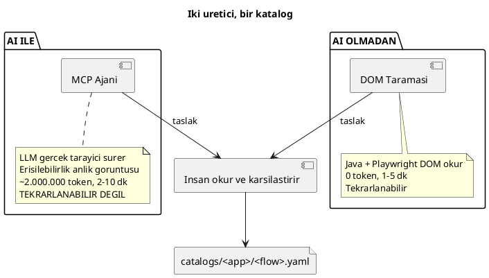
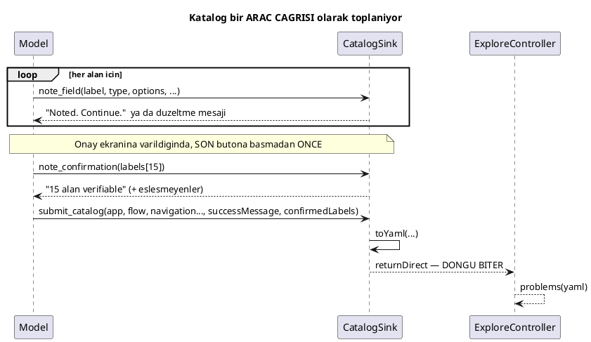

# AI ile YAML (Katalog) Üretimi — ekranın sözlüğü nasıl çıkarılıyor

Bu doküman **tek bir şeyi** anlatıyor: bir ekranın kataloğu nasıl üretiliyor.
Arayüzdeki **"Katalog Üret"** düğmesi ve onun AI kullanmayan kardeşi **"Ekranı
Keşfet"**.

Hiçbir şey bilmediğiniz varsayılıyor.

> **Önce şunu okuyun:** [`AI-GEZ-VE-KESFET.md`](AI-GEZ-VE-KESFET.md). Buradaki
> ajan, oradaki ajanın ta kendisi — aynı sistem promptu, aynı araç döngüsü, aynı
> koruyucular, aynı bütçe. Bu doküman yalnızca **farkı** anlatıyor: üç ek araç,
> prompta eklenen şema, ve ürünün düzyazı yerine YAML olması. Mekanizmayı
> tekrarlamıyor.

## İçindekiler

1. [Katalog nedir, ne DEĞİLDİR](#1-katalog-nedir-ne-değildir)
2. [Üç tüketici — ve yalnızca birinin zorlaması](#2-üç-tüketici--ve-yalnızca-birinin-zorlaması)
3. [İki üretici, zıt kör noktalar](#3-iki-üretici-zıt-kör-noktalar)
4. [Ajan yolu — `/explore/catalog`](#4-ajan-yolu--explorecatalog)
5. [Üç araç, ve neden üç tane](#5-üç-araç-ve-neden-üç-tane)
6. [YAML'ı model yazmıyor: `toYaml`](#6-yamlı-model-yazmıyor-toyaml)
7. [Sözleşme: SCHEMA.md'den çıkana kadar takip et](#7-sözleşme-schemamdden-çıkana-kadar-takip-et)
8. [`problems()` — kimse okumadan önce](#8-problems--kimse-okumadan-önce)
9. [DOM taraması yolu — `/discovery`](#9-dom-taraması-yolu--discovery)
10. [Taslak → katalog: insan okuması](#10-taslak--katalog-insan-okuması)
11. [Kaydetme ve dosya düzeni](#11-kaydetme-ve-dosya-düzeni)
12. [Ne bozulabilir](#12-ne-bozulabilir)
13. [Sık sorulan sorular](#13-sık-sorulan-sorular)
14. [Doğrulanmamışlar ve bilinen eksikler](#14-doğrulanmamışlar-ve-bilinen-eksikler)

---

## 1. Katalog nedir, ne DEĞİLDİR

Katalog, bir ekranın **sözlüğü**: hangi alanlar var, tipleri ne, açılır
listelerde hangi seçenekler var, ekrana nasıl gidiliyor.

```yaml
app: NGC
flow: Fatura Oluştur

navigation:
  main_menu: "NAKİT YÖNETİMİ"
  sub_menu: "Online DBS İşlemleri"
  entry_row: "FORD DBS ODEMELERI"
  entry_button: "Fatura Oluştur"
  entry_choice: "Bilgi Girişi"

fields:
  - label: "Bayi Kodu"
    type: dropdown
    options: ["93002"]
    verifiable: true
  - label: "Bayi Ünvanı"
    type: text
    readonly: true          # uygulama kendisi dolduruyor
    verifiable: true
  ...

buttons: ["Devam", "Onay"]
success_message: "Fatura Oluşturma işleminiz başarıyla gerçekleşmiştir."
```

### 1.1 Test verisi TAŞIMAZ

Katalogda tek bir fatura numarası, tutar ya da tarih yok. Olmamalı. Formül:

```
senaryo  =  katalog (İSİMLER)  +  intent (FİİLLER ve DEĞERLER)  +  sözlük (GRAMER)
            ───────────────       ───────────────────────────      ──────────────
            "Bayi Kodu" diye      "1,00 TL'lik fatura              enter / select /
            bir alan var ve       oluşturmayı dene"                verify ...
            seçenekleri ["93002"]
```

Bunun sonucu: **TEK katalog, ONLARCA senaryoya hizmet ediyor.** Analist veriyi
kataloğa dokunmadan değiştirebiliyor.

### 1.2 Şablon DEĞİL

Şablon olsaydı tek bir senaryo üretirdi. Katalog olduğu için aynı dosyadan beş
farklı senaryo çıkabiliyor — ve daha önemlisi, doğrulayıcı üretilen senaryoyu
ona **karşı kontrol edebiliyor**. Bir şablonu kontrol edemezsiniz; ona göre
üretirsiniz.

### 1.3 Giriş bilgisi TAŞIMAZ

Katalog bir ekranı tarif ediyor, kimin giriş yaptığını değil. CIF ve kullanıcı
kodu üretim anında ayrıca veriliyor. `app` anahtarı üretecin doğru login adımını
seçmesi için yeterli — NGC kurumsal (cif + userid), NGI bireysel (müşteri kodu).

---

## 2. Üç tüketici — ve yalnızca birinin zorlaması

Katalog üç yere gidiyor ve **üçü de farklı şey yapıyor**. Bir anahtarın
"çalışıp çalışmadığı" hangisine gittiğine bağlı.

```
                     catalogs/ngc/dbs-ai-v2.yaml
                                │
          ┌─────────────────────┼─────────────────────┐
          ▼                     ▼                     ▼
   ┌─────────────┐     ┌────────────────┐    ┌──────────────────┐
   │ PromptBuilder│     │  CatalogModel  │    │ VariationPlanner │
   │             │     │                │    │                  │
   │ YAML'ı modele│     │ Ayrıştırır,    │    │ N kombinasyon    │
   │ AYNEN verir  │     │ doğrulayıcıya  │    │ hesaplar         │
   │             │     │ cevap verir    │    │                  │
   │ HER ŞEY      │     │ YALNIZCA bazı  │    │ shown_when +     │
   │ okunur       │     │ anahtarlar     │    │ kısıt anahtarları│
   └─────────────┘     └────────────────┘    └──────────────────┘
      yönlendirir          ZORLAR               çeşitlendirir
```

### 2.1 Ne zorlanıyor, ne yalnızca tavsiye

| Anahtar | `CatalogModel` | Sonuç |
|---|---|---|
| `fields.label`, `.type`, `.options`, `.accounts`, `.readonly` | **ayrıştırır + ZORLAR** | Yanlışsa doğrulama hatası |
| `success_message` | **ayrıştırır + ZORLAR** | Modelin kendi kelimeleriyle yazması hata |
| `navigation.entry_row` | **ayrıştırır + ZORLAR** | `click` ile tıklanması hata (ve otomatik düzeltilir) |
| `shown_when` | ayrıştırır, **zorlamaz** | `VariationPlanner` kullanır; doğrulayıcı bakmaz |
| `max_length`, `min`, `max`, `numeric` | ayrıştırır, **zorlamaz** | `VariationPlanner` kullanır |
| `navigation.main_menu`, `sub_menu`, `entry_tab`, `entry_choice` | **ayrıştırmaz** | Yalnızca modele metin olarak gider |
| `verifiable` | **ayrıştırmaz** | Yalnızca modele metin olarak gider |
| `buttons` | **ayrıştırmaz** | Yalnızca modele metin olarak gider |

**Bu tablonun pratik anlamı şu:** yanlış bir `entry_tab` bir doğrulama hatası
DEĞİL. Bir tarayıcıda otuz saniyelik zaman aşımı, ve hiç açılmamış bir formun
ilk alanına fatura kesiliyor.

```
ZORLANAN bir anahtar yanlissa:   ekranda saniyeler icinde, kirmizi bir satir
ZORLANMAYAN bir anahtar yanlissa: tarayicida dakikalar sonra, alakasiz bir hata
```

### 2.2 Ayrıştırma bilerek HOŞGÖRÜLÜ

`CatalogModel` bir şema doğrulayıcısı **değil** ve asla olmamalı:

- Bilinmeyen anahtarlar yok sayılıyor
- Eksik anahtarlar hata değil
- Hiç ayrıştırılamayan bir katalog, katalog kontrollerini **kapatıyor** —
  isteği başarısız etmiyor

Sebebi: bir katalogu ya bir analist yazıyor ya da keşif üretiyor. İkisi de bu
sınıfın bir fikri yüzünden engellenmemeli.

---

## 3. İki üretici, zıt kör noktalar

Katalog üretmenin iki yolu var. **İkisi de taslak üretiyor, ikisi de tek başına
yetmiyor** — ve her biri diğerini yanlışlarken yakaladı.



ASCII karşılığı:

```
   ┌─ AJAN (AI var) ────────────┐     ┌─ TARAMA (AI yok) ────────────┐
   │ LLM gerçek tarayıcı sürer  │     │ Java + Playwright DOM okur   │
   │ ~2.000.000 token, 2-10 dk  │     │ 0 token, 1-5 dk              │
   │ tekrarlanabilir DEĞİL      │     │ tekrarlanabilir              │
   │                            │     │                              │
   │ İYİ: yolu bulmak, onay     │     │ İYİ: tipleri ÖLÇMEK,         │
   │      ekranı, başarı mesajı │     │      max_length, readonly    │
   │ KÖR: tip tahmini, DOM      │     │ KÖR: başarı mesajı,          │
   │      attribute'ları        │     │      fieldcontainer dışı     │
   └──────────┬─────────────────┘     └──────────┬───────────────────┘
              └──────────────┬────────────────────┘
                             ▼
                  ┌──────────────────────┐
                  │  İNSAN İKİSİNİ OKUR  │  ◄── atlanamaz
                  └──────────┬───────────┘
                             ▼
                catalogs/<app>/<flow>.yaml
```

### 3.1 Yalnızca taramanın görebildikleri

| Ne | Neden yalnızca o |
|---|---|
| Select2 **v4** mü **v3** mü | Ekranda **birebir aynı** görünüyorlar. Ayıran şey DOM: v4'ün kapalı widget'ı `.select2-selection` taşıyor. Yalnızca v4'ü süren bir adım var; v3 `UNSUPPORTED_V3` diye işaretlenip tahmine kurban edilmiyor |
| Bir tutarın **iki input** olduğu | `input[id$='-integer']` / `-decimal`. Ekran görüntüsünde tek bir kutu gibi duruyor |
| `max_length`, `min`, `max`, `numeric` | Bunlar DOM **attribute**'ları. Erişilebilirlik ağacında **hiç yok** |
| `readonly` | Ekran durumunu doldurma ÖNCESİ/SONRASI diff'leyerek **ölçülüyor** |
| Bağımlılıklar | "Bayi Kodu seçilince Bayi Ünvanı doldu, Döviz Cinsi'nin seçenekleri yüklendi" |

### 3.2 Yalnızca ajanın görebildikleri

| Ne | Neden yalnızca o |
|---|---|
| Ekrana giden yol | Menü, alt menü, sekme, ızgara satırı, formu açan düğme. Bir insanın ilk kez keşfetmesi gereken şey |
| Onay ekranı | Tarama son düğmeye hiç basmıyor |
| `success_message` | Aynı sebep — sonuç ekranını görmüyor |
| Tarama seçicisinin kaçırdığı alanlar | Tarama yalnızca `fieldcontainer` içine bakıyor ve "Ek Bilgi"yi kaçırdı |

### 3.3 Neden ikisi birden

```
                  AJAN                      TARAMA
   yolu bulmak      ✓ iyi                     ✗ analist yazmalı
   onay ekranı      ✓ okur                    ✗ ulaşamaz
   başarı mesajı    ✓ okur                    ✗ ulaşamaz
   tip (v3/v4)      ✗ göremez                 ✓ ÖLÇER
   iki kutulu tutar ✗ tahmin                  ✓ ÖLÇER
   max_length       ✗ göremez                 ✓ OKUR
   tekrarlanabilir  ✗ aynı ekran bir koşuda "Ay", ötekinde "Ay, Hafta, Gün" verdi
                                              ✓ her seferinde aynı
```

Yeni bir ekranda **ikisini de koşun ve farkı okuyun.** "Ek Bilgi" alanı ve
kaçırılmış bir `verifiable` tam olarak böyle bulundu.

---

## 4. Ajan yolu — `/explore/catalog`

### 4.1 Düzyazı uçtan tek farkı

| | `/api/v1/explore` ("Gez ve Anlat") | `/api/v1/explore/catalog` ("Katalog Üret") |
|---|---|---|
| Sistem promptu | `SYSTEM` | `SYSTEM` + `CATALOG_RULES` + **`SCHEMA.md`** |
| Ek araçlar | yok | `note_field`, `note_confirmation`, `submit_catalog` |
| Talimatın sonuna eklenen | yok | `CLOSING` (dört satır) |
| Ürün | düzyazı metin | `{catalog, problems}` |

Geri kalan her şey — araç döngüsü, bütçe, koruyucular, tarayıcı profili —
birebir aynı. [`AI-GEZ-VE-KESFET.md`](AI-GEZ-VE-KESFET.md).

### 4.2 `SCHEMA.md` prompta AYNEN giriyor

```java
schema = Files.readString(catalogs.root().resolve("SCHEMA.md"), StandardCharsets.UTF_8);
...
.system(SYSTEM + CATALOG_RULES + schema)
```

Şema kodda **yeniden yazılmıyor**, dosyadan okunuyor. Sebep `PromptBuilder`'ın
sözlüğü canlı executor'dan almasıyla aynı: elle kopyalanmış bir şema ikinci bir
doğruluk kaynağıdır ve birisi bir alan anahtarı eklediği ilk gün ayrışır.

**Bunun iki ucu keskin.** Model şemada yazan her anahtarı **okuyor** — ama
yalnızca araçlarda karşılığı olanı **söyleyebiliyor**. Bu ayrım 7. bölümün
tamamı.

Maliyeti de var: `SCHEMA.md` 14.380 karakter ≈ 3.800 token, ve her turda
yeniden gidiyor. Katalog uç noktasının sistem promptu ~8.200 token ile
başlıyor; düzyazı ucu ~2.200 ile.

### 4.3 `CLOSING` — talimatın sonuna eklenen dört satır

```
Bitirmek için submit_catalog'u çağır ve HER argümanını doldur:
ekrana nasıl gittiğini (menü, alt menü, varsa geçtiğin sekme, varsa
ızgaradan seçtiğin satır, varsa formu açan bağlantı), bastığın
düğmeleri, son ekranda okuduğun metni, ve değerlerini tekrar
gösteren ekranda gördüğün tüm etiketleri. Bir şey gerçekten yoksa
"" geç — atlamak yok.
```

**Hiç yeni bilgi taşımıyor.** Hepsi `CATALOG_RULES` içinde zaten iki kez yazılı.
Değişen tek şey **konum**: bu, modelin başlamadan önce okuduğu son metin, ve
"bunu sonda yap" talimatının ait olduğu yer orası. Maliyeti dört satır.

Ve sistem promptuna değil **analistin metnine** ekleniyor, çünkü düzyazı ucunda
`submit_catalog` diye bir araç yok — verilmemiş bir aracı çağırmasını söylemek,
bir koşunun uydurma bir araç adıyla bitmesinin yoludur.

> **Dikkat edilen bir ayrıntı:** bu metinde **gerçek hiçbir düğme adı geçmiyor.**
> Birleştirilmiş talimat, `BudgetedTool`'un "talimatta geçmeyen şeye dokunma"
> kontrolünün içinde arama yaptığı metnin ta kendisi. Buraya "Onay" yazmak,
> analistin hiç anmadığı bir akışta Onay'a basmayı **sessizce serbest
> bırakırdı**. O yüzden "son onay düğmesi" ve "değerlerini tekrar gösteren
> ekran" deniyor.

---

## 5. Üç araç, ve neden üç tane



### 5.1 `note_field` — alan alan, o anda

Alternatif şu olurdu: sonda tek bir çağrıda tüm alan listesini iç içe nesneler
olarak göndermek. Üç sebeple reddedildi:

1. **Küçük bir modelden çok şey ister** — tek bir dev çağrı.
2. **Erken görülen her şey kırk tur hayatta kalmak zorunda kalır.** Üçüncü turda
   okunan bir etiket, kırkıncı turda hatasız yazılmalı.
3. **Yarıda ölen bir koşu hiçbir şey bırakmaz.** Alan alan kaydedilince kısmi
   bir katalog kurtarılabiliyor (`partialYaml()`).

### 5.2 `note_confirmation` — sorunun cevabının olduğu yer

Bu aracın hikayesi, bu projedeki en öğretici tasarım dersi.

`verifiable` (bu alan onay ekranında tekrar görünüyor mu?) başlangıçta
`note_field`'ın bir **argümanıydı** ve **her koşuda boş geldi**.

Dikkatsizlik değildi. Bir alan **form doldurulurken** kaydediliyor; uygulamanın
o değeri geri gösterip göstermediği ise ancak **gönderimden sonra**, ajanın
henüz açmadığı bir ekranda bilinebiliyor. Henüz ulaşmadığı bir ekran hakkında
"bunu tekrar gördün mü?" diye sorulduğunda **tek dürüst cevap hayır.**

Prompt bu bayrağı uzun uzun anlattı ve yardımcı olamadı. **Hiçbir ifade,
cevaplanamaz bir soruyu cevaplanabilir yapmaz.**

Soru, cevabın var olduğu ana taşındı: onay ekranındayken **bir kez** çağrılan
kendi aracına.

> **Genel kural:** her soruyu cevabının var olduğu yerde sorun.

Ve geri konuşuyor: onay ekranında yazan ama hiç `note_field` ile kaydedilmemiş
bir etiket varsa onu **bildiriyor** — yürüyüşün kaçırdığı alanlar böyle
yüzeye çıkıyor.

### 5.3 `submit_catalog` ve `returnDirect`

```java
@Tool(name = "submit_catalog", returnDirect = true, ...)
```

Bu olmadan araç modele "görev bitti, başka araç çağırma" **diyordu** — ve model
devam ediyordu, akışı baştan yürüyordu. İstek hiç dönmüyordu, ve arayüz cevabı
alınca düğmesini tekrar açtığı için analistin "Katalog Üret" düğmesi **sonsuza
dek** devre dışı kalıyordu. İki belirti, tek sebep.

`returnDirect` sonucu modele değil **doğrudan çağırana** veriyor. Yani devam
edilecek bir sonraki tur **yok**.

`BudgetedTool` de `CatalogSink.isClosed()` sonrası her çağrıyı reddediyor —
emniyet ağı olarak.

### 5.4 Zorunlu argüman, ve `""` ile "yoktu" demek

`submit_catalog`'un `entryTab`, `entryRow`, `entryButton`, `entryChoice`,
`successMessage` ve `confirmedLabels` argümanları **zorunlu**. Hep öyle
değillerdi.

Opsiyonel oldukları dönemde koşu üstüne koşu `null` geldiler — hem de
talimatın değerleri **harfi harfine saydığı** bir koşuda bile
(`entryRow = FORD DBS ODEMELERI`). O çağrının dağılımı hikâyenin tamamı:

```
ZORUNLU argumanlarin HEPSI geldi     : app, flow, mainMenu, subMenu, confirmedLabels(15 etiket)
OPSIYONEL argumanlarin neredeyse hicbiri : entryRow, entryTab, entryButton, successMessage → null
```

> **Bir model, şemanın TALEP ETTİĞİNİ doldurur; yalnızca İZİN VERDİĞİNİ atlar.**

Çözüm promptta daha sert bir cümle değil — `required = false`'u silmek ve
`""`'yi "yoktu demenin yolu" olarak belgelemek.

Hasar sessizdi, ve üç koşu boyunca fark edilmemesinin sebebi bu: `toYaml` bir
navigasyon anahtarını yalnızca doluysa yazıyor, yani **düşürülmüş bir argüman,
o özelliği hiç olmayan bir ekrana birebir benziyor.**

### 5.5 `note_field` geri konuşuyor

Boş bir dropdown kaydedildiğinde araç artık "Continue." demiyor:

```
RECORDED, BUT INCOMPLETE: "Bayi Kodu" is a dropdown and you gave no options
and no reason.
A closed dropdown on this application contains NOTHING — the list is built
when you click it...
  1. Click it open, read the list, close it, and call note_field again...
  2. If you DID open it and it really was empty — a field whose options only
     load once another field is chosen — call note_field again with the same
     empty list AND put the reason in `uncertain`.
```

Neden gerekliydi: sistem promptu bunu **zaten büyük harfle** söylüyordu
(*"TO LEARN THE OPTIONS YOU HAVE TO OPEN IT"*) ve ajan yine dört dropdown'ı boş
bıraktı.

**Prompt koşunun başında bir kez okunuyor; aracın dönüş değeri hatanın yapıldığı
anda, düzeltilebilecek ekranda geliyor.**

Alan **yine de kaydediliyor**, reddedilmiyor: ajan şikâyeti okuyup yoluna devam
ederse alanı tamamen kaybetmek, seçeneksiz bir alandan kötüdür.

### 5.6 Boş liste iki şey demek

Bir dropdown'un boş gelmesi iki ayrı şey olabilir ve ikisi zıt eylem gerektiriyor:

| Durum | Anlamı | Ne yapılmalı |
|---|---|---|
| sebep YOK | Ajan muhtemelen **hiç açmadı** | Yürüyüşü tekrarla |
| sebep VAR (`uncertain`) | **Açtı ve gerçekten boştu** — bağımlı bir liste, ebeveyni seçilmeden yüklenmiyor | Analist elle doldursun |

"Döviz Cinsi", "Bayi Kodu" seçilene kadar gerçekten boş. Bu bir gerçek, bir
eksik değil.

Sebep `uncertain`'e yazılıyor ve YAML'a `# emin degil: <sebep>` yorumu olarak
düşüyor.

> **Önemli bir incelik:** o yorum **geri okunamıyor.** `problems()` taslağı
> `CatalogModel` ile yeniden ayrıştırıyor ve SnakeYAML yorumları atıyor. Bu
> yüzden sebep `CatalogSink.emptyChoiceReasons()`'dan raporlanıyor — tıpkı
> `missedOnConfirmation()` gibi. **Bir YAML yorumunun taşıdığı her şey, o
> YAML'ın sonraki her okuyucusuna görünmezdir.**

---

## 6. YAML'ı model yazmıyor: `toYaml`

"Sadece YAML yaz, başka bir şey yazma" denildiğinde model önce sayfalarca
gerekçe yazıyordu ("...Kataloğu güncelliyorum:" sonra YAML).

Çözüm: katalog bir **araç çağrısı** oldu. Üç şeyi birden düzeltti:

```
┌───────────────────────────────────────────────────────────────────┐
│ ① ŞEKLİ ŞEMA ZORLUYOR, modelin disiplini değil                   │
│    "type" bir enum — "string" ya da "textbox" yazılamaz           │
│    Eksik bir etiket, modele bildirilen bir şema hatası            │
├───────────────────────────────────────────────────────────────────┤
│ ② YAML'ı BİZİM KODUMUZ render ediyor (CatalogSink.toYaml)        │
│    Modelin metninin hiçbir parçası içeri sızamıyor                │
├───────────────────────────────────────────────────────────────────┤
│ ③ ARACI ÇAĞIRMAK "bitirdim" demek                                 │
│    Bir cümlenin nasıl bittiğinden çıkarım yapmaya gerek yok       │
└───────────────────────────────────────────────────────────────────┘
```

Her anahtar `present()` ile korunuyor: boş geçilen bir argüman satırı hiç
yazmıyor. Bu, `""`'nin "yoktu" anlamına gelmesini mümkün kılan şey.

---

## 7. Sözleşme: SCHEMA.md'den çıkana kadar takip et

Bu bölüm **aynı hatanın üç kez** olduğu bölüm.

### 7.1 Üç tekrar

```
SCHEMA.md     →     submit_catalog     →     toYaml     →     YAML
 (belgelendi)        (arguman)               (render)         (cikti)

entry_tab        ✓ vardi              ✗ DUSURULDU        ✗ yok
entry_choice     ✗ YOKTU              ✗ yok              ✗ yok
shown_when       ✗ YOKTU              ✗ yok              ✗ yok
```

**Birincisi** — `entry_tab` argüman olarak **kabul ediliyordu** ve `toYaml` onu
sessizce atıyordu. Banko kataloğu, ajanın gösterilebilir biçimde tıkladığı
"Ödenecekler" sekmesi hakkında hiçbir şey söylemiyordu, ve bu bir tur boyunca
"ajan sekmeyi unutmuş" diye okundu.

**İkincisi ve üçüncüsü daha kötü:** `entry_choice` ve `shown_when` şemada
belgelenmişti ama **hiç argümanları yoktu**. Ve `SCHEMA.md` prompta aynen
giriyor — yani model her iki anahtarı da **okuyordu** ve cevabı koyacak hiçbir
yer bulamıyordu.

DBS'nin radyo çatalını (`Oluşturma Tipi`) büyük ihtimalle **gördü**. Söyleyecek
yeri olmadığı için gözlem buharlaştı.

Bu "AI unutmuş" gibi okunuyor, ki tamamen yanlış ders.

### 7.2 Üçü de SESSİZ

`entry_choice`'ı olmayan bir katalog, çatalı olmayan bir ekranın kataloğuna
birebir benziyor. `problems()` bunu yakalayamaz — kontrol edilecek bir sinyal
yok, ekranı görmeden "burada bir yol ayrımı vardı" denemez.

### 7.3 Üçüncüsünde kontrol mekanikleşti

`uptest-orchestrator/src/test/java/orchestrator/explore/CatalogContractTest.java`

Test bir **gidiş-dönüş**, metin taraması değil:

```
1. catalogs/SCHEMA.md oku, ilk `navigation:` blogundaki anahtarlari cikar
2. submit_catalog'u YANSIMA ile cagir, HER argumani doldurarak
3. uretilen YAML'da her anahtar `<key>:` olarak var mi?
```

Üç başarısızlık biçimini birden yakalıyor:

| Durum | Test |
|---|---|
| anahtar belgelendi, argüman yok | değer geçilemez → YAML'da yok → **düşer** |
| argüman var, `toYaml` atıyor | → YAML'da yok → **düşer** |
| tam bağlı | → **geçer** |

**İmzadan bağımsız** — argümanlar yansıma ile bulunup tipe göre dolduruluyor.
`submit_catalog`'a bir argüman eklemek testi değiştirmeyi gerektirmiyor.
Değiştirilmesi gereken bir sözleşme testi, unutulacak bir şey daha demek.

Yazılırken **önce kırık halde koşturuldu** ve tam da beklendiği gibi düştü:

```
Expecting empty but was: ["entry_choice"]
```

Geçtiğini görmeden önce düştüğünü görmeyen bir test hiçbir şey kanıtlamaz.

---

## 8. `problems()` — kimse okumadan önce

Modelden YAML isteyince, katalog olsa da olmasa da **katalog gibi görünen** bir
şey geliyor. `ExploreController.problems()` mekanik olarak bulunabilecekleri
buluyor. Ucuz, ve dakikalar sonra bir tarayıcıda çıkacak hataları yakalıyor.

**Raporlar, asla düzeltmez.** Modelin ne demek istediğini tahmin etmek, kataloğa
ikinci bir yazar koyar ve görülmeye değer hatayı gizler.

| Kontrol | Hangi gerçek taslaktan doğdu |
|---|---|
| Tip SCHEMA.md'de yok | Hiçbir adımın süremediği bir tip |
| Seçim alanı ama seçenek yok, **sebep de yok** | Ajan dropdown'ı hiç açmadı — dört tanesi birden |
| Seçim alanı, seçenek yok ama **sebep var** | Bağımlı liste; analist doldurmalı (farklı cümle, farklı eylem) |
| `shown_when` var **ve** seçenekleri dolu | Ajan "listesi sonradan geldi"yi "alan sonradan belirdi" sandı. `Döviz Cinsi`'ne `shown_when: Bayi Kodu = 93002` koydu |
| `main_menu` / `sub_menu` yok | Ekrana nasıl gidileceği yazılı değil |
| `entry_button` var ama `entry_row` yok | Ekran bir ızgaradan açılıyorsa satır eksik, senaryo yanlış kaydı açar |
| `success_message` var ama hiç `verifiable` yok | Sonuç ekranına ulaşılmış, demek onay ekranından geçilmiş, ama kaydedilmemiş |
| `verifiable` var ama `success_message` yok | Onay ekranında durdu, son düğmeye basmadı |
| 15 alandan yalnızca 3'ü `verifiable` | Özet tablosu yarıda okunmuş olabilir — **soru, hüküm değil** |

### 8.1 `shown_when` yanlış konduğunda neden pahalı

Bu kontrol sonradan eklendi ve sebebi tek yönlü bir maliyet:

```
VariationPlanner: tetikleyici degeri secmeyen HER senaryoda alani DISLIYOR

  5 secenekli bir ebeveyn + yanlis shown_when
     → yalnizca 1 senaryo alani doldurur
     → diger 4'u ona DOKUNMAZ
     → zorunlu bir alan 4 kosuda bos kalir, form reddeder
```

Eksik bir `shown_when` ise hep ekranda olan bir alan için **hiçbir şeye mal
olmuyor**. Asimetri bu, ve kontrolün var olma sebebi bu.

Gerçek koşullu alanlar (`E-Fatura Hash Kodu`, `Vergisiz Tutar`) düz kutular,
seçim alanı değil — bu yüzden kontrol onlara yanlış alarm vermiyor.

---

## 9. DOM taraması yolu — `/discovery`

**Burada hiç model yok.** Hiçbir LLM çağrısı yapılmıyor.

### 9.1 Nasıl çalışıyor

Orchestrator, analistin formundan **sentetik bir Gherkin senaryosu** yazıyor ve
onu sıradan bir koşu gibi `ExecutorPool` üzerinden executor'a gönderiyor:

```gherkin
Feature: Katalog kesfi

  Scenario: Ekrani kesfet
    Given login with cif "DI00002018" and userid "3014"
    And navigate to "NAKİT YÖNETİMİ" "Online DBS İşlemleri"
    And select row "FORD DBS ODEMELERI"
    And click "Fatura Oluştur"
    Then discover screen catalog
    And fill discovered fields:
      | Bayi Kodu    | 93002 |
      | Toplam Tutar | 1,00  |
    And click "Devam"
    Then discover screen catalog
```

```
  ANALIST          ORCHESTRATOR                 EXECUTOR
     │                   │                          │
     │ POST /discovery   │                          │
     ├──────────────────►│                          │
     │                   │ sentetik feature kur     │
     │                   │ ExecutorPool.dispatch    │
     │                   ├─────────────────────────►│
     │◄──────────────────┤ 202 {runId, executor}    │ Cucumber + Playwright
     │                   │                          │ DOM'u gez
     │ GET /discovery/{id}                          │ catalog-draft.yaml yaz
     ├──────────────────►│                          │
     │                   │ GET /status ────────────►│
     │                   │ DONE → artefakti cek ───►│
     │                   │ header() + taslak        │
     │◄──────────────────┤ {catalogYaml}            │
```

### 9.2 İki adım sözlükte YAYINLANMIYOR

`discover screen catalog` ve `fill discovered fields:` adımları
`VocabularyExtractor` tarafından **bilerek** dışarıda bırakılıyor —
`discovery` paketi hariç tutuluyor.

Sebep: bunlar bir ekranı **okuyor**, bir testi tanımlamıyor, ve üretecin
bunları asla yazmaması gerekiyor.

Bu yüzden elle `@Given/@When/@Then` sayınca **22**, `GET /api/v1/vocabulary`
deyince **20** çıkıyor. Fark bu iki adım.

Ve bu yüzden keşif koşusu `ScenarioValidator`'ı **bilerek atlıyor** — kendi
senaryosu doğrulamadan geçemezdi.

### 9.3 Başlığı orchestrator yazıyor

Executor **hangi uygulamaya giriş yaptığını bilmiyor** — yalnızca üstünde
durduğu ekranı görüyor. O yüzden `app`, `flow` ve `navigation` bloğunu
orchestrator ekliyor (`CatalogDiscoveryService.header()`), alan listesini
executor'ın taslağından alıyor.

---

## 10. Taslak → katalog: insan okuması

> **Bir taslak, bir insan okuyana kadar katalog değildir.**

`problems()` mekanik olanı buluyor. Bulamadığı şeyler:

- Bir etiketin **gerçekten ekranda yazdığı gibi** olup olmadığı
- Bir tipin doğru tahmin edilip edilmediği (ajan tahmin ediyor)
- Bir seçenek listesinin **eksik** olup olmadığı — "93002" tek bayi mi, yoksa
  ajan listeyi açmadı mı?
- `verifiable` bayrağının doğru olup olmadığı

Pratik yöntem: **ikisini de koşun, farkı okuyun.** Bir üretici diğerinin
göremediğini ölçüyor.

Gerçek bir örnek — bu projede yaşandı:

```
AJAN   : Bayi Kodu → options: ["93002"]
EKRAN  : 93001, 93002, 93003, 93004, 93005   ← analist bakti, bes tane var

Sonuc  : kombinasyon tavani 1'den 5'e cikti; coklu uretim ilk kez
         anlamli cesitlilik verebildi
```

---

## 11. Kaydetme ve dosya düzeni

```
POST /api/v1/scenarios/catalogs
{ "app": "ngc", "flow": "dbs-fatura-olustur", "yaml": "app: NGC\n..." }
         ↓
<catalogs.dir>/ngc/dbs-fatura-olustur.yaml
```

`catalogs.dir=./catalogs` — **orchestrator'ın çalıştığı dizine göre.** Yani
kataloglar kod değil **veri**: VDI'da uygulamayı hangi dizinden başlattıysanız
oradaki `catalogs/` klasörü.

Dosya adları `[A-Za-z0-9._-]{1,64}` ile sınırlı — dizin dışına çıkmayı
engelliyor.

**Kasten doğrulanmıyor** (isim dışında). Ajanın kendi ucu taslaktaki sorunları
zaten raporladı ve analist okuyup muhtemelen düzenledi. Burada kusurlu bir
kataloğu reddetmek, saklamaya değer bir taslağın tek yolunu "elle dosyaya
yapıştırmak" yapardı — ki değiştirilmek istenen şey tam olarak buydu.

Kaydedilir kaydedilmez katalog "AI Üret" ve "Çoklu Üret" listelerinde görünüyor.

---

## 12. Ne bozulabilir

| Belirti | Sebep | Ne yapmalı |
|---|---|---|
| "dropdown ama hic secenek yazilmamis **ve sebep de yazilmamis**" | Kapalı bir açılır liste bu uygulamada **hiçbir şey içermiyor**; liste tıklanınca kuruluyor | Yürüyüşü tekrarla; `note_field` artık ajanı geri çeviriyor |
| "...ama **sebep var**" | Bağımlı liste, ebeveyni seçilmeden boş | Analist elle doldursun — ajanın hatası değil |
| "hem shown_when tasiyor hem secenekleri dolu" | "listesi sonradan geldi" ile "alan sonradan belirdi" karıştırıldı | Ekranda bak: **etiket mi yoktu, yoksa etiket vardı da içi mi boştu?** |
| "success_message var ama hicbir alan verifiable degil" | Sonuç ekranına ulaşıldı ama onay ekranı kaydedilmedi | `note_confirmation`'ı vurgula, yeniden yürüt |
| "Alanlar verifiable ama success_message yok" | Onay ekranında durdu, son düğmeye basmadı | Talimatta son onayı açıkça iste |
| "Talimat su kontrollere dokunulmasini istedi, ajan hicbirini denemedi" | `ZORUNLU:` atlandı. **En sessiz hata** — sonraki her adım DOĞRU ama YANLIŞ ekranda | Kataloğu kullanma, yeniden yürüt |
| "Model submit_catalog'u cagirmadi" | Koşu yarıda kaldı. Tarayıcı kaybolmuş olabilir — bkz. [§14.1](#141-iptal-kapısı-eksiksiz-bir-kataloğu-çöpe-atıyor) | Logu oku: `No open pages` arıyorsun |
| Katalogda `max_length` yok | Ajan taslağı; erişilebilirlik ağacı attribute taşımıyor | DOM taramasını da koş — ama önce [§14.2](#142-dom-taraması-dbs-formuna-ulaşamıyor) |
| `success_message` bir HATA mesajı | Yürüyüş mükerrer bir kayda denk geldi ("Bu Fatura Zaten Mevcut") | Benzersiz veriyle tekrar koş; ajan uydurmadı, gördüğünü yazdı |

---

## 13. Sık sorulan sorular

**Katalog ile senaryo arasındaki fark ne?**
Katalog ekranı tarif eder ve test verisi taşımaz; senaryo bir testtir ve
değerleri vardır. Bir katalog onlarca senaryoya hizmet eder.

**Her senaryo için katalog üretmem gerekiyor mu?**
Hayır. **Ekran başına bir kez.** Katalog üretimi Faz 0; günlük iş akışı
senaryo üretimi.

**Ajan mı daha iyi, tarama mı?**
Hiçbiri. Kör noktaları zıt ve her biri diğerini yanlışlarken yakaladı. Yeni bir
ekranda ikisini de koşun.

**Katalogu elle yazabilir miyim?**
Evet, ve bazı şeyler zaten elle yazılmak zorunda — `shown_when` hiçbir üretici
tarafından tam olarak üretilemiyor. Şema: [`SCHEMA.md`](../catalogs/SCHEMA.md).

**Taslak doğrulanmadan kaydediliyor, bu tehlikeli değil mi?**
Kaydetme ucu kasten doğrulamıyor, ama `problems()` zaten raporladı ve analist
okudu. Ayrıca kusurlu bir kataloğun ürettiği senaryo **doğrulayıcıdan** geçmek
zorunda — oradaki kontroller bu dosyaya değil, üretilen senaryoya bakıyor.

**`SCHEMA.md`'yi değiştirirsem ne olur?**
Üç şey birden: modelin promptu değişir, dokümantasyon değişir, ve
`CatalogContractTest` yeni bir navigasyon anahtarı eklendiyse **build'i
kırar** — araçta karşılığı olana kadar. Bu kasıtlı.

---

## 14. Doğrulanmamışlar ve bilinen eksikler

### 14.1 İptal kapısı eksiksiz bir kataloğu çöpe atıyor — **açık hata**

Gerçek bir koşuda ajan `submit_catalog`'u **eksiksiz** argümanlarla çağırdı —
`entryChoice: "Bilgi Girişi"` dahil — ve çağrı **reddedildi**, çünkü hemen
öncesinde "Onay"a basıldığında tarayıcı kaybolmuş ve `aborted` kurulmuştu.

`BudgetedTool.refuse()`'un ilk satırı `if (aborted.get()) return CLOSED;` ve bu,
BROWSER araçları için doğru. Ama `submit_catalog` hiçbir tarayıcıya dokunmuyor;
elindeki argümanlardan YAML üretiyor. Sınıf bu üçlüyü zaten `RECORDING` diye
tanıyor ama o küme yalnızca başka bir kontrolde kullanılıyor.

**Sonuç:** tarayıcı kaybolduğunda ajanın topladığı her şey kayboluyor ve
`partialYaml()`'a düşülüyor — navigation'ı boş bir taslak. **Düzeltilmedi.**

### 14.2 DOM taraması DBS formuna ulaşamıyor — **açık hata**

`CatalogDiscoveryService.buildFeature()` şu adımları üretiyor:

```
login → navigate → select row → click entry_button → discover screen catalog
```

**`entry_tab` yok. `entry_choice` yok.** `DiscoverRequest` bu iki alanı hiç
taşımıyor.

DBS Fatura Oluştur'da "Fatura Oluştur" düğmesi formu değil bir **çatal** açıyor
(`Oluşturma Tipi`). Yani tarama o çatal ekranını tarıyor ve formun 16 alanına
**hiç ulaşmıyor**.

Bunun pratik sonucu büyük: `max_length` ve `numeric`'in **tek kaynağı** tarama,
ve bu ekranda tarama çalışamıyor. `Taksit Adedi`'ne `"TESTVERISI4"` gitmesinin
gerçek sebebi yalnızca "panel arayüzde kapalı" değil — **API'den çağrılsa bile
yanlış ekranı tarardı.**

Aynı boşluğun diğer yarısı da var: `header()` `entry_tab` ve `entry_choice`
yazmıyor, yani tarama bu anahtarları üretemiyor.

**Ve `CatalogContractTest` bunu yakalamıyor** — test yalnızca `CatalogSink`'i
kapsıyor, `CatalogDiscoveryService`'i değil. Sözleşmenin yarısı korumasız.

### 14.3 `shown_when`'i hiçbir üretici tam üretemiyor

- **DOM taraması:** formu hiçbir şey doldurulmadan okuyor, yani bir seçimin
  açtığı alan henüz orada değil.
- **MCP ajanı:** artık argümanı var, ama yalnızca yürüyüş koşulu **tetiklediyse**
  görebiliyor. Talimat "Fatura Tipi = Normal" diyorsa "E-Fatura Hash Kodu" hiç
  belirmez.

Her dropdown değerini tek tek denetmek **bilerek yapılmadı**: formu değiştirmek
demek, ve "talimat dokunabileceğin şeylerin tam listesidir" kuralını kırar.

### 14.4 `verifiable` koşullu alanlarda ölçülmedi

`E-Fatura Hash Kodu` ve `Vergisiz Tutar` kataloglarda `verifiable: true` olarak
duruyor, ama **hiçbir ajan yürüyüşü E-Fatura ya da E-Arşiv seçmedi** — hepsi
"Normal" ile geçti. Yani bu iki alanın onay ekranında görünüp görünmediği
`note_confirmation` ile hiç doğrulanmadı. Kardeşleriyle tutarlı olsun diye true.

### 14.5 "Seçiniz" plaseholder'ı taslaklara sızabiliyor

`selectableOptions` değeri olmayan, disabled ya da gizli bir seçeneği atıyor; bu
uygulama ise plaseholder'ına **gerçek bir değer** veriyor. `Döviz Cinsi` bir kez
`options: ["Seçiniz"]` olarak geldi — bir senaryonun asla seçmemesi gereken tek
şey.

Çözüm için `UPTEST_DISCOVERY_DEBUG=true` ile bir koşu yapıp
`nativeOptions=[value=text]` dökümünü okumak ve kuralı oradan yazmak gerekiyor.
Türkçe kelimeye göre eşleştirmek **yapılmamalı**.

### 14.6 Ajan onay tablosunda satır kaçırıyor

İki kez, bir ekran görüntüsünün varlığını gösterdiği `"Orijinal Fatura Tutarı"`
alanını o ekranda yok diye raporladı. `browser_snapshot`'ın bir derinlik sınırı
olduğu şüphesi var ama **test edilmedi**.

Bu yöndeki hata zararsız — eksik bir `verifiable` testi zayıflatır, yanlış bir
tanesi koşuyu düşürür — ama ajanın `verifiable` bayrakları bu yüzden taramayla
karşılaştırılıyor.

---

## İlgili dokümanlar

- [`AI-GEZ-VE-KESFET.md`](AI-GEZ-VE-KESFET.md) — buradaki ajanın mekanizması:
  MCP, araç döngüsü, kuadratik token büyümesi, `BudgetedTool`'un yedi kapısı,
  tarayıcı profili. **Bu dokümandan önce okunmalı.**
- [`COKLU-SENARYO-AKISI.md`](COKLU-SENARYO-AKISI.md) — bu katalogdan beş
  senaryo nasıl çıkıyor. `VariationPlanner`, kombinasyon sayacı, doğrulayıcı.
- [`DETERMINISTIK-AKIS.md`](DETERMINISTIK-AKIS.md) — üretilmiş senaryonun
  koşması. Orada AI hiç yok.
- [`../catalogs/SCHEMA.md`](../catalogs/SCHEMA.md) — katalog şemasının kendisi.
  Prompta aynen giren dosya, ve `CatalogContractTest`'in okuduğu sözleşme.
- [`../CLAUDE.md`](../CLAUDE.md) — kazanılmış dersler; buradaki tasarım
  kararlarının çoğunun kısa hâli orada.
